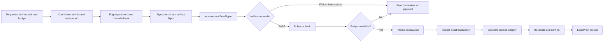
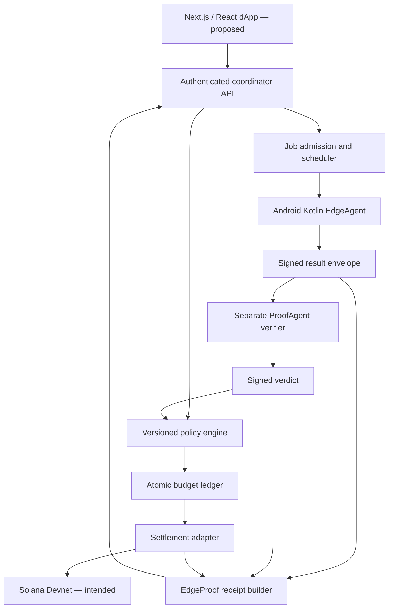

> **Hardening update, 2026-11-08:** GitHub Pages remains the landing page. The Next.js app is prepared for a separate Vercel deployment using shared Neon PostgreSQL session storage. Public deployment is not yet verified. Demo sessions expire after 30 minutes; all job payments remain simulated. See [audit results](docs/AUDIT.md), [deployment instructions](docs/DEPLOYMENT.md), and [security limits](SECURITY.md). Older design sections below describe planned capabilities, not implemented guarantees.

# EdgeSwarm — Verifiable Edge-Agent Work Prototype

**Quick answer (version 0.1.0, November 2026):** EdgeSwarm is an Apache-2.0 open-source Next.js and Kotlin prototype for bounded edge-agent tasks. Its web demo creates jobs, signs deterministic results, checks evidence locally, and shows simulated credit receipts. Android P-256 signing exists as a local prototype; real-device interoperability and Solana Devnet settlement are not yet verified.

**Run locally (Node.js 22 recommended):**

```bash
git clone https://github.com/CodesbyFebin/EdgeSwarm.git
cd EdgeSwarm
npm install
npm test
npm run build
npm run dev
```

See [source](https://github.com/CodesbyFebin/EdgeSwarm), [issues](https://github.com/CodesbyFebin/EdgeSwarm/issues), [license](LICENSE), [submission status](SUBMISSION.md), and [development history](CHANGELOG.md). This is a private npm package, **not** a published `npm install EdgeSwarm` dependency. Never connect real funds to the unauthenticated demo.


> **Mobile integration update:** A connected ten-screen mobile prototype is available at `/mobile` after running the Next.js server. It uses the existing local Jobs API and supports job creation, signed deterministic execution, verification checks, and simulated demo-credit receipts. Mobile swipe navigation is supported. This is **not** the complete uploaded Embla/Framer Motion source package; that full source has been separately audited and packaged. No wallet connection, real Solana Devnet transfer, independent verifier deployment, or production authentication has been verified. Do not expose the unauthenticated demo API publicly.


> **Implementation update (2026-11-08):** A local Next.js demonstrator is now committed in `app/`, `lib/`, and `tests/`. Run `npm install && npm test && npm run dev` locally. It includes signed worker results, local separately keyed verification, deterministic replay, and **simulated demo-credit settlement only**. It does **not** have production authentication, a deployed independent verifier, Android execution, or real Solana payments. Do not deploy it publicly or connect real funds. The Node test suite and Next.js production build passed in GitHub Actions run #22 on the draft PR branch (2026-11-08); Android builds and real Solana payments remain unverified.

<div align="center">


### Sovereign Verifiable Agent Network · Solana-native dApp concept


**Coordinate bounded edge-device work. Independently verify results. Connect accepted evidence to policy-controlled settlement on Solana.**

[Overview](#overview) · [How it works](#how-edgeswarm-works) · [Architecture](#technical-architecture) · [Jobs](#jobs-and-use-cases) · [Demo](#video-demo-and-animated-walkthrough) · [Security](#security-model-and-limitations) · [Roadmap](#roadmap) · [FAQ](#frequently-asked-questions) · [Contributing](#contributing)


</div>


<!-- Exactly twenty badge images. Dynamic GitHub badges read public repository metadata;
     the remaining badges describe intended technology, scope, and project stage. -->
<div align="center">


</div>

**Badge integrity:** The first eight badges query public GitHub metadata through Shields.io and can change as the repository evolves. The remaining twelve badges are **descriptive design-stage labels**, not CI, security-audit, production-availability, performance, or deployment certifications. Do not replace them with “passing,” “audited,” or “live” labels without corresponding evidence.

## Overview

**EdgeSwarm** is a proposed Solana-native coordination layer for verifiable work performed by AI agents and edge devices. Its guiding principle is simple: **a worker should not be paid merely because it says a job succeeded**. Instead, a requester defines a bounded task, a worker executes that task under explicit constraints, a separate verifier checks the submitted evidence, and settlement is authorized only when the result meets the selected policy. A signed receipt connects the request, assignment, output, verifier decision, and payment reference.

EdgeSwarm is designed for a future in which people and applications can contribute useful computing resources without handing over unlimited authority. A phone may execute a small inference job. A server may transform a dataset. A verifier may independently reproduce a deterministic result. A Solana transaction may then settle an approved amount under a controlled budget. These are the target interactions. They are not claims that the current repository already performs them.

The project combines **edge computing**, **agent orchestration**, **cryptographic provenance**, **independent verification**, **wallet-based identity**, and **Solana settlement**. Its first proposed application, **GossipMarket**, focuses on bounded public-source snapshots and reproducible transformations. That application is a useful demonstration because a reviewer can inspect the source digest, the transformed artifact, the worker signature, the independent verdict, and the final payment state.

This README is intentionally structured for three readers at once. A newcomer can understand the product in a minute. An engineer can inspect the contracts, trust boundaries, and suggested repository layout. A search engine or AI answer system can extract clear definitions, constraints, and answers without having to infer the product from marketing language. Headings, terminology, concise summaries, and explicit implementation labels are used for clarity—not as a guarantee of ranking, citation, or indexing.

### Project at a glance

| Question | Answer |
|---|---|
| What is EdgeSwarm? | A proposed network and dApp for coordinating edge-device jobs, independently checking results, and linking verified work to controlled settlement. |
| What blockchain is targeted? | Solana, with Devnet as the intended initial integration environment. |
| What is the core workflow? | **Create → Authorize → Execute → Verify → Reserve → Settle → Receipt**. |
| What is EdgeAgent? | A proposed Android/Kotlin or host worker that executes bounded tasks and signs results. |
| What is ProofAgent? | A proposed independent verifier that checks signatures, inputs, outputs, and task-specific correctness conditions. |
| What is EdgeProof? | A proposed evidence/receipt format that binds work, identities, policies, and settlement references. |
| What is EdgePool? | The planned coordination and capability pool for available agents and devices. |
| What is GossipMarket? | A planned first workload for source snapshot processing and reproducible data transformation. |
| Does the repo currently contain a live dApp? | **No live implementation was confirmed** at the time of inspection. |
| Is there a recorded demo video? | **Not yet provided**; a video slot and filming runbook appear below. |
| Is the GIF a product recording? | **No**; it is a labeled concept animation. |
| Can the README itself prove a payment occurred? | No. A confirmed transaction and independently inspectable receipt are required. |

### The central idea

Traditional task marketplaces can coordinate work, but the requester may still need to trust a worker's self-reported success. EdgeSwarm proposes a stronger separation of duties. The worker produces evidence. The verifier evaluates it against a trusted task definition. The settlement authority checks the verdict, authorization, recipient, amount, and budget before constructing a transaction. This separation is intended to make failure observable and reduce the risk of paying for incorrect, tampered, stale, or unauthorized outputs.

The phrase **“verifiable agent network”** refers to a design goal with several possible evidence strengths. A valid signature proves that a key signed a message. A matching hash proves byte integrity relative to a known digest. Independent re-execution can establish reproducibility for a deterministic task. None of these alone proves that arbitrary real-world work happened exactly as claimed. EdgeSwarm's interface and receipts should name the actual verification method and its limitations.

## Video demo and animated walkthrough

<div align="center">


**Concept animation — not a screen recording or proof of deployed functionality.**

</div>

### Recorded video demo — publication slot

**Video status:** Not yet recorded or published. The README deliberately does not embed a fabricated YouTube video, invent a watch URL, or imply that a working app was captured. When a real demo exists, replace this paragraph with an actual thumbnail linked to the recording and note the commit SHA, execution environment, testnet, device model, and transaction signature.

A recommended final embed, to be filled only with real identifiers, is:

```md
[](YOUR_REAL_VIDEO_URL)
```

**What the video should demonstrate:** start with a requester creating a deterministic job; show the exact input digest and budget; show a worker actually processing the task; display the signed result; show a separately executed verifier checking the result; inspect the verdict and provenance receipt; and, if implemented, display a confirmed Solana Devnet transaction. Repeat with a deliberately tampered result and demonstrate that no payment is authorized.

A polished demo does not need invented network-wide statistics. It needs a clear causal sequence. For example, “job accepted,” “worker signature verified,” “output independently reproduced,” “budget reserved,” and “transaction confirmed” are meaningful milestones only when the backing system actually recorded those events. If the final segment uses a mock adapter, display **Simulated Settlement** prominently.

### Live GitHub widgets

These widgets are live **repository metadata**, not live EdgeSwarm network telemetry:

[](https://github.com/CodesbyFebin/EdgeSwarm)


The activity graph is a third-party widget based on the maintainer account and may be unavailable or incomplete. It is **not** a chart of verified agent executions. GitHub metadata badges may be cached. If a widget fails to load, the repository's native Issues, Pull Requests, and Insights pages remain the source of truth. No worker uptime, verified-job throughput, Solana volume, or network-health metric should be presented until an actual telemetry endpoint exists.

## How EdgeSwarm works



The diagram is a **target design**, not a diagram of a verified deployment.

### Stage 1: Create and authorize

A requester chooses a supported template, supplies or references the input, defines the output contract, and sets limits on compute, memory, runtime, network access, and cost. The coordinator validates the task, records a versioned policy, and checks that the requester is authorized to spend the proposed amount. The task should be immutable after admission, or any change should create a new task version and invalidate previous authorizations.

The user-facing review screen should explain the maximum exposure before any signature or wallet approval. It should show the selected token, network, payer, permitted recipient, deadline, and verification strategy. A wallet connection alone is not permission to transfer funds. The distinction between “connected,” “authorized,” “reserved,” and “settled” must remain visible.

### Stage 2: Assign and execute

The scheduler chooses an eligible device using capabilities and policy rather than a worker's unsupported claims. An assignment binds the worker public key, job ID, input digest, unique nonce, lease expiry, and task policy. The worker downloads authorized inputs, performs a bounded computation, and signs a result envelope. The coordinator must not accept arbitrary output from an unassigned key.

The worker may run on Android or a host process, depending on the implemented executor. The Android app should protect its private key using platform-supported secure storage where practical and disclose device resource consumption. The project should avoid unrestricted code execution until sandboxing, quotas, and abuse handling have been designed and tested.

### Stage 3: Independently verify

ProofAgent receives trusted task data and the worker's signed result. It checks the assignment, signer, nonce, expiry, policy, input hash, and output digest. It then performs the task-specific verification method: deterministic replay, schema validation, cross-source corroboration, or another explicitly documented check. A worker cannot declare its own result “verified” merely by setting a flag.

A passing verdict should include the verifier identity, policy version, method, observed digests, timestamp, and signature. If the verifier cannot establish the required result property, it should return `INCONCLUSIVE` or `FAIL` with a reason. The user interface must not quietly convert an inconclusive result into a success.

### Stage 4: Recheck policy and reserve budget

A passing verdict is necessary but not sufficient for settlement. The coordinator checks the current authorization and revocation state, verifies the approved recipient and token, checks the job's deadline and amount, and atomically reserves budget. A uniqueness constraint prevents duplicate reservation for the same settlement intent. The reservation and ledger entries should be durable across process restarts.

This is an important distinction for the project description: a coordinator database can enforce local accounting, but that is not the same as a Solana program enforcing an on-chain allowance. The README must name the actual enforcement boundary once implementation exists.

### Stage 5: Submit, reconcile, and record

The settlement adapter prepares a transaction, inspects its exact instructions and account metas, submits it, and tracks the result. A timeout is not evidence that the transfer failed. The adapter must persist the signed transaction identity and reconcile ambiguous outcomes before constructing a replacement payment.

Once the required commitment level is reached, EdgeProof links the job, result, worker, verifier, policy, amount, token, and transaction signature in an inspectable receipt. A user should be able to open a receipt from the Jobs page and understand what was checked, who approved payment, and whether settlement was confirmed or merely submitted.

## Product pillars

### Execute — useful bounded work

EdgeSwarm's execution layer is intended to let real devices contribute compute under explicit consent and resource limits. “Edge” does not mean every task is suitable for a phone. Some tasks require GPUs, large memory, reliable network access, or trusted data sources. The platform should match workloads to capability and allow devices to opt out of expensive or privacy-sensitive jobs.

### Verify — evidence appropriate to the task

Verification is a spectrum. A deterministic transformation can often be independently replayed. A model inference may be compared within an accepted tolerance. A sensor reading may be signed and cross-checked but cannot necessarily be proven physically accurate. EdgeSwarm should expose these distinctions instead of presenting a universal “99.99% verified” claim.

### Settle — authorization and accountability

The settlement layer is designed around controlled amounts, explicit recipients, unique payment intents, and reconciliation. Solana offers an environment in which transactions can be inspected and referenced, but blockchain settlement does not itself prove the off-chain computation was correct. That is why the verification and settlement layers must remain distinct.

### Own — control your participation

Worker operators should choose which workloads are permitted, set resource ceilings, manage device keys, revoke access, and inspect payouts. Requesters should control budget and verification requirements. Privacy, device consent, and clear exit controls are part of the product—not optional polish.

### Inspect — explain every outcome

Every significant transition should produce a durable event: admission, assignment, execution, submission, verification, reservation, transaction submission, confirmation, or rejection. A receipt should be useful even to someone who does not trust the UI. The goal is not to hide complexity, but to make it understandable at the right level of detail.

### Dashboard — page design and behavior

**Purpose.** A role-aware overview of network connectivity, active personal jobs, available agents, pending verdicts, reserved budgets, and recent events.

**Layout and interaction.** The first fold should show the current environment, an honest connection state, and two primary actions: Browse Jobs and Register Agent. The globe artwork belongs in the hero, not behind dense data. Requesters see spending exposure; worker operators see resource usage and pending earnings. The page should use the dark Solana-inspired design language: midnight surfaces, cyan and violet accents, green reserved for successful states, and a restrained border glow. On desktop, use a sidebar and contextual detail drawer; on mobile, use a single-column page with a sticky primary action where appropriate. Each interactive icon needs a visible label or accessible name.

**Data and state model.** A newcomer sees an onboarding checklist rather than fabricated network statistics. A disconnected wallet does not prevent browsing public information. Cached data includes its last refresh time. A failed verifier is reported as degraded service rather than hidden behind a green global banner. The frontend should query authoritative backend state and expose loading, empty, disconnected, stale, permission-denied, and retryable-error states. If real data is unavailable, show a truthful placeholder rather than synthetic values disguised as live metrics. Real-time events must be reconciled against the backend after reconnection.

**Trust and safety.** Avoid claiming global node count, transaction volume, or verification rate without a real measurement endpoint. KPI definitions must specify their scope and time window. The product copy must differentiate the current concept from tested functionality. Acceptance criteria should cover small-screen layouts, keyboard and screen-reader use, API authorization, refresh/restart recovery, and correct display of every lifecycle state.

**Implementation handoff.** Create a route, a typed view model, reusable cards, a role-aware action menu, and automated tests for both success and failure paths. Include a screenshot in the pull request and record the backend endpoint or fixture source for each number displayed. This makes the page independently reviewable and avoids a common failure mode in attractive dApps: visual success states that are not actually connected to transaction or verification state.

### Jobs — page design and behavior

**Purpose.** A searchable operational marketplace and task control center for requesters, workers, and verifiers.

**Layout and interaction.** Use separate Available, My Work, and Created tabs. Filters include template, reward, device capability, verification method, deadline, and lifecycle status. Each card displays immutable task identity, estimated resource consumption, policy requirements, and whether the viewing user is eligible. The page should use the dark Solana-inspired design language: midnight surfaces, cyan and violet accents, green reserved for successful states, and a restrained border glow. On desktop, use a sidebar and contextual detail drawer; on mobile, use a single-column page with a sticky primary action where appropriate. Each interactive icon needs a visible label or accessible name.

**Data and state model.** An expired job cannot be accepted. A running job shows measured progress or an indeterminate state, never an invented percentage. A rejected job exposes a safe reason code. A settled job links to the actual receipt and, where applicable, a real transaction. The frontend should query authoritative backend state and expose loading, empty, disconnected, stale, permission-denied, and retryable-error states. If real data is unavailable, show a truthful placeholder rather than synthetic values disguised as live metrics. Real-time events must be reconciled against the backend after reconnection.

**Trust and safety.** Bulk actions must not accidentally authorize transfers. The table must not conflate verified with paid, or assigned with executing. The product copy must differentiate the current concept from tested functionality. Acceptance criteria should cover small-screen layouts, keyboard and screen-reader use, API authorization, refresh/restart recovery, and correct display of every lifecycle state.

**Implementation handoff.** Create a route, a typed view model, reusable cards, a role-aware action menu, and automated tests for both success and failure paths. Include a screenshot in the pull request and record the backend endpoint or fixture source for each number displayed. This makes the page independently reviewable and avoids a common failure mode in attractive dApps: visual success states that are not actually connected to transaction or verification state.

### Create Job — page design and behavior

**Purpose.** A guided, risk-aware wizard that turns a human request into an immutable bounded assignment.

**Layout and interaction.** The steps are Template, Inputs, Constraints, Verification, Budget, and Review. Input artifacts are hashed. Constraints set runtime, memory, allowed network destinations, and retries. Verification explains its evidence limits. The final review shows payer, token, recipient rule, maximum cost, and expiry. The page should use the dark Solana-inspired design language: midnight surfaces, cyan and violet accents, green reserved for successful states, and a restrained border glow. On desktop, use a sidebar and contextual detail drawer; on mobile, use a single-column page with a sticky primary action where appropriate. Each interactive icon needs a visible label or accessible name.

**Data and state model.** A failed upload preserves the draft without treating it as admitted. Changing the input after approval requires a new digest and authorization. Insufficient budget produces a clear error. Wallet network mismatch blocks financial authorization. The frontend should query authoritative backend state and expose loading, empty, disconnected, stale, permission-denied, and retryable-error states. If real data is unavailable, show a truthful placeholder rather than synthetic values disguised as live metrics. Real-time events must be reconciled against the backend after reconnection.

**Trust and safety.** No automatic wallet signatures or hidden approvals. Show integer token amounts and decimals precisely; do not use floating-point math for funds. The product copy must differentiate the current concept from tested functionality. Acceptance criteria should cover small-screen layouts, keyboard and screen-reader use, API authorization, refresh/restart recovery, and correct display of every lifecycle state.

**Implementation handoff.** Create a route, a typed view model, reusable cards, a role-aware action menu, and automated tests for both success and failure paths. Include a screenshot in the pull request and record the backend endpoint or fixture source for each number displayed. This makes the page independently reviewable and avoids a common failure mode in attractive dApps: visual success states that are not actually connected to transaction or verification state.

### Job Detail — page design and behavior

**Purpose.** A single source of truth for a job's task specification, assignment, evidence, and settlement history.

**Layout and interaction.** The header shows job ID, title, lifecycle state, requester, template version, and deadline. A vertical event timeline connects admission to execution, verification, and settlement. Tabs expose Overview, Inputs, Worker, Verification, Payment, and Audit Trail. The page should use the dark Solana-inspired design language: midnight surfaces, cyan and violet accents, green reserved for successful states, and a restrained border glow. On desktop, use a sidebar and contextual detail drawer; on mobile, use a single-column page with a sticky primary action where appropriate. Each interactive icon needs a visible label or accessible name.

**Data and state model.** A user without permission can see only public metadata. Stale assignments are marked expired. Multiple execution attempts are individually identifiable. A verdict is displayed with its evidence method and verifier identity. The frontend should query authoritative backend state and expose loading, empty, disconnected, stale, permission-denied, and retryable-error states. If real data is unavailable, show a truthful placeholder rather than synthetic values disguised as live metrics. Real-time events must be reconciled against the backend after reconnection.

**Trust and safety.** Never treat the worker-provided status as authoritative. Avoid displaying private artifact contents or sensitive hashes to unauthorized viewers. The product copy must differentiate the current concept from tested functionality. Acceptance criteria should cover small-screen layouts, keyboard and screen-reader use, API authorization, refresh/restart recovery, and correct display of every lifecycle state.

**Implementation handoff.** Create a route, a typed view model, reusable cards, a role-aware action menu, and automated tests for both success and failure paths. Include a screenshot in the pull request and record the backend endpoint or fixture source for each number displayed. This makes the page independently reviewable and avoids a common failure mode in attractive dApps: visual success states that are not actually connected to transaction or verification state.

### Agents — page design and behavior

**Purpose.** A device enrollment and health console for Android workers and other supported execution hosts.

**Layout and interaction.** Show device type, registered public key fingerprint, capabilities, software version, last heartbeat, battery and thermal status when consented, active assignment, and pause/revoke controls. Pairing requires proof of key possession. Device policies constrain compute and network use. The page should use the dark Solana-inspired design language: midnight surfaces, cyan and violet accents, green reserved for successful states, and a restrained border glow. On desktop, use a sidebar and contextual detail drawer; on mobile, use a single-column page with a sticky primary action where appropriate. Each interactive icon needs a visible label or accessible name.

**Data and state model.** Offline is not the same as revoked. Pausing blocks new jobs but may not stop in-flight work instantly. Key rotation and device ownership transfer require explicit authorization and audit records. The frontend should query authoritative backend state and expose loading, empty, disconnected, stale, permission-denied, and retryable-error states. If real data is unavailable, show a truthful placeholder rather than synthetic values disguised as live metrics. Real-time events must be reconciled against the backend after reconnection.

**Trust and safety.** Do not advertise hardware-backed security without actual device attestation. Avoid collecting personal device data unrelated to task execution. The product copy must differentiate the current concept from tested functionality. Acceptance criteria should cover small-screen layouts, keyboard and screen-reader use, API authorization, refresh/restart recovery, and correct display of every lifecycle state.

**Implementation handoff.** Create a route, a typed view model, reusable cards, a role-aware action menu, and automated tests for both success and failure paths. Include a screenshot in the pull request and record the backend endpoint or fixture source for each number displayed. This makes the page independently reviewable and avoids a common failure mode in attractive dApps: visual success states that are not actually connected to transaction or verification state.

### EdgePool — page design and behavior

**Purpose.** A capability and scheduling view for the collection of participating devices and worker groups.

**Layout and interaction.** Display eligible worker counts by capability, region only where consented and necessary, scheduler queue, task leases, and capacity estimates. A pool detail page explains routing rules and selection reasons. Administrators can drain or disable a pool with audited actions. The page should use the dark Solana-inspired design language: midnight surfaces, cyan and violet accents, green reserved for successful states, and a restrained border glow. On desktop, use a sidebar and contextual detail drawer; on mobile, use a single-column page with a sticky primary action where appropriate. Each interactive icon needs a visible label or accessible name.

**Data and state model.** Capacity estimates are labeled estimates. A heartbeat older than the configured threshold marks a worker stale. Draining a pool does not retroactively invalidate already completed work unless policy says so. The frontend should query authoritative backend state and expose loading, empty, disconnected, stale, permission-denied, and retryable-error states. If real data is unavailable, show a truthful placeholder rather than synthetic values disguised as live metrics. Real-time events must be reconciled against the backend after reconnection.

**Trust and safety.** Do not imply decentralized consensus merely because several devices appear on a map. The coordinator's trust role should be documented. The product copy must differentiate the current concept from tested functionality. Acceptance criteria should cover small-screen layouts, keyboard and screen-reader use, API authorization, refresh/restart recovery, and correct display of every lifecycle state.

**Implementation handoff.** Create a route, a typed view model, reusable cards, a role-aware action menu, and automated tests for both success and failure paths. Include a screenshot in the pull request and record the backend endpoint or fixture source for each number displayed. This makes the page independently reviewable and avoids a common failure mode in attractive dApps: visual success states that are not actually connected to transaction or verification state.

### Verification — page design and behavior

**Purpose.** An evidence workbench for signed worker results and independently issued verdicts.

**Layout and interaction.** The main table shows job, assignment, worker key, verifier key, evidence method, verdict, policy version, and timestamp. A proof inspector recomputes digests, displays signature checks, and provides safe access to allowed artifacts. Expert users can inspect canonical signed bytes. The page should use the dark Solana-inspired design language: midnight surfaces, cyan and violet accents, green reserved for successful states, and a restrained border glow. On desktop, use a sidebar and contextual detail drawer; on mobile, use a single-column page with a sticky primary action where appropriate. Each interactive icon needs a visible label or accessible name.

**Data and state model.** Tampered output produces a fail reason. Missing evidence produces inconclusive, not pass. A revoked verifier cannot issue new acceptable verdicts. Reverification is controlled by policy and recorded as a new attempt. The frontend should query authoritative backend state and expose loading, empty, disconnected, stale, permission-denied, and retryable-error states. If real data is unavailable, show a truthful placeholder rather than synthetic values disguised as live metrics. Real-time events must be reconciled against the backend after reconnection.

**Trust and safety.** A signature is not proof of semantic correctness. Display exact evidence levels and their limits; do not call a digest comparison a zero-knowledge proof. The product copy must differentiate the current concept from tested functionality. Acceptance criteria should cover small-screen layouts, keyboard and screen-reader use, API authorization, refresh/restart recovery, and correct display of every lifecycle state.

**Implementation handoff.** Create a route, a typed view model, reusable cards, a role-aware action menu, and automated tests for both success and failure paths. Include a screenshot in the pull request and record the backend endpoint or fixture source for each number displayed. This makes the page independently reviewable and avoids a common failure mode in attractive dApps: visual success states that are not actually connected to transaction or verification state.

### Settlement — page design and behavior

**Purpose.** A financial control room for payment intents, reservations, transaction submission, confirmation, and reconciliation.

**Layout and interaction.** Show token, mint, network, payer, recipient, amount, allowance, reservation, transaction signature, and finality. Distinct states are Not Eligible, Reserved, Submitting, Unknown, Confirmed, and Failed. The confirmation screen links to the appropriate Solana explorer cluster. The page should use the dark Solana-inspired design language: midnight surfaces, cyan and violet accents, green reserved for successful states, and a restrained border glow. On desktop, use a sidebar and contextual detail drawer; on mobile, use a single-column page with a sticky primary action where appropriate. Each interactive icon needs a visible label or accessible name.

**Data and state model.** An RPC timeout leaves the state Unknown until reconciliation. A confirmed payment cannot be canceled from the UI. A duplicate settlement intent resolves to its existing record rather than initiating a new transfer. The frontend should query authoritative backend state and expose loading, empty, disconnected, stale, permission-denied, and retryable-error states. If real data is unavailable, show a truthful placeholder rather than synthetic values disguised as live metrics. Real-time events must be reconciled against the backend after reconnection.

**Trust and safety.** No fake explorer links. No claims of on-chain program-enforced limits without a deployed and tested program. The product copy must differentiate the current concept from tested functionality. Acceptance criteria should cover small-screen layouts, keyboard and screen-reader use, API authorization, refresh/restart recovery, and correct display of every lifecycle state.

**Implementation handoff.** Create a route, a typed view model, reusable cards, a role-aware action menu, and automated tests for both success and failure paths. Include a screenshot in the pull request and record the backend endpoint or fixture source for each number displayed. This makes the page independently reviewable and avoids a common failure mode in attractive dApps: visual success states that are not actually connected to transaction or verification state.

### Marketplace — page design and behavior

**Purpose.** A catalog of supported agent templates, workloads, and optional service providers.

**Layout and interaction.** Listings specify what is actually supported, the input and output schema, verification method, resource needs, privacy considerations, and pricing model. Use maturity badges: Demo Ready, Experimental, Planned. Include templates for deterministic data processing, bounded inference, media checks, and GossipMarket. The page should use the dark Solana-inspired design language: midnight surfaces, cyan and violet accents, green reserved for successful states, and a restrained border glow. On desktop, use a sidebar and contextual detail drawer; on mobile, use a single-column page with a sticky primary action where appropriate. Each interactive icon needs a visible label or accessible name.

**Data and state model.** Unsupported templates remain viewable for discovery but cannot be purchased or executed. A provider's self-declared capabilities are distinct from tested capabilities. Users can report suspicious workloads. The frontend should query authoritative backend state and expose loading, empty, disconnected, stale, permission-denied, and retryable-error states. If real data is unavailable, show a truthful placeholder rather than synthetic values disguised as live metrics. Real-time events must be reconciled against the backend after reconnection.

**Trust and safety.** Do not present hypothetical earnings or arbitrary token rewards as guaranteed income. Moderation and abuse policies are required before opening third-party listings. The product copy must differentiate the current concept from tested functionality. Acceptance criteria should cover small-screen layouts, keyboard and screen-reader use, API authorization, refresh/restart recovery, and correct display of every lifecycle state.

**Implementation handoff.** Create a route, a typed view model, reusable cards, a role-aware action menu, and automated tests for both success and failure paths. Include a screenshot in the pull request and record the backend endpoint or fixture source for each number displayed. This makes the page independently reviewable and avoids a common failure mode in attractive dApps: visual success states that are not actually connected to transaction or verification state.

### Analytics — page design and behavior

**Purpose.** An evidence-backed reporting area for task outcomes, verification quality, resource usage, and financial exposure.

**Layout and interaction.** Provide filters by role, date range, template, network, and status. Charts cover job completion, verification outcomes, median duration, budget reserved versus settled, reconciliation lag, and device availability. Each chart has a clear denominator and time window. The page should use the dark Solana-inspired design language: midnight surfaces, cyan and violet accents, green reserved for successful states, and a restrained border glow. On desktop, use a sidebar and contextual detail drawer; on mobile, use a single-column page with a sticky primary action where appropriate. Each interactive icon needs a visible label or accessible name.

**Data and state model.** No-data periods show zero or missing distinctly. Cached charts show last updated time. Exported reports preserve definitions and units. A failed API request does not silently leave old numbers labeled live. The frontend should query authoritative backend state and expose loading, empty, disconnected, stale, permission-denied, and retryable-error states. If real data is unavailable, show a truthful placeholder rather than synthetic values disguised as live metrics. Real-time events must be reconciled against the backend after reconnection.

**Trust and safety.** A 'verification rate' must specify pass verdicts divided by attempts, not an unqualified percentage. Do not fabricate global scale. The product copy must differentiate the current concept from tested functionality. Acceptance criteria should cover small-screen layouts, keyboard and screen-reader use, API authorization, refresh/restart recovery, and correct display of every lifecycle state.

**Implementation handoff.** Create a route, a typed view model, reusable cards, a role-aware action menu, and automated tests for both success and failure paths. Include a screenshot in the pull request and record the backend endpoint or fixture source for each number displayed. This makes the page independently reviewable and avoids a common failure mode in attractive dApps: visual success states that are not actually connected to transaction or verification state.

### Governance — page design and behavior

**Purpose.** A future policy administration console, not a claim that a DAO or token voting system already exists.

**Layout and interaction.** Show policy versions, role assignments, verifier allowlists, key revocations, maximum spending rules, and incident controls. Proposed changes include a diff, rationale, reviewer, effective time, and rollback procedure. Every sensitive action emits an audit event. The page should use the dark Solana-inspired design language: midnight surfaces, cyan and violet accents, green reserved for successful states, and a restrained border glow. On desktop, use a sidebar and contextual detail drawer; on mobile, use a single-column page with a sticky primary action where appropriate. Each interactive icon needs a visible label or accessible name.

**Data and state model.** Revocation should take effect according to a documented epoch and invalidate new eligibility decisions. Emergency pause blocks new settlements while allowing reconciliation of previously submitted transactions. The frontend should query authoritative backend state and expose loading, empty, disconnected, stale, permission-denied, and retryable-error states. If real data is unavailable, show a truthful placeholder rather than synthetic values disguised as live metrics. Real-time events must be reconciled against the backend after reconnection.

**Trust and safety.** Do not call administrator-controlled settings decentralized governance. On-chain governance would require an actual deployed voting and execution mechanism. The product copy must differentiate the current concept from tested functionality. Acceptance criteria should cover small-screen layouts, keyboard and screen-reader use, API authorization, refresh/restart recovery, and correct display of every lifecycle state.

**Implementation handoff.** Create a route, a typed view model, reusable cards, a role-aware action menu, and automated tests for both success and failure paths. Include a screenshot in the pull request and record the backend endpoint or fixture source for each number displayed. This makes the page independently reviewable and avoids a common failure mode in attractive dApps: visual success states that are not actually connected to transaction or verification state.

### Developer Tools — page design and behavior

**Purpose.** A reproducibility and integration hub for engineers building on the proposed protocol.

**Layout and interaction.** Expose versioned API schemas, signing test vectors, local mock adapters, webhook/event examples, verification reason codes, and a CLI once implemented. Provide copyable commands and exact expected outputs. A sandbox should demonstrate safe negative tests. The page should use the dark Solana-inspired design language: midnight surfaces, cyan and violet accents, green reserved for successful states, and a restrained border glow. On desktop, use a sidebar and contextual detail drawer; on mobile, use a single-column page with a sticky primary action where appropriate. Each interactive icon needs a visible label or accessible name.

**Data and state model.** If a feature is not shipped, mark its snippet as illustrative. An API playground must not expose private keys or submit real transactions without confirmation. Examples pin protocol and library versions. The frontend should query authoritative backend state and expose loading, empty, disconnected, stale, permission-denied, and retryable-error states. If real data is unavailable, show a truthful placeholder rather than synthetic values disguised as live metrics. Real-time events must be reconciled against the backend after reconnection.

**Trust and safety.** Developer trust depends on runnable tests and stable contracts, not a large catalog of aspirational SDK badges. The product copy must differentiate the current concept from tested functionality. Acceptance criteria should cover small-screen layouts, keyboard and screen-reader use, API authorization, refresh/restart recovery, and correct display of every lifecycle state.

**Implementation handoff.** Create a route, a typed view model, reusable cards, a role-aware action menu, and automated tests for both success and failure paths. Include a screenshot in the pull request and record the backend endpoint or fixture source for each number displayed. This makes the page independently reviewable and avoids a common failure mode in attractive dApps: visual success states that are not actually connected to transaction or verification state.

## Technical architecture

The proposed architecture separates user experience, scheduling, untrusted execution, independent verification, evidence storage, and settlement. This separation is more important than the number of services. An early prototype may run several modules in one Node.js process, but the trust model must say so. The phrase “independent verifier” should be reserved for a verifier that checks evidence without relying on a worker's self-declared success and that operates under a documented separate trust boundary.



### Coordinator responsibilities

The coordinator authenticates requesters and devices, validates immutable job specifications, checks policy, leases assignments, tracks state transitions, accepts signed results, routes evidence to the verifier, and coordinates payment eligibility. It should never trust client-provided amounts, worker-provided recipient addresses, or unverifiable claims of device capability. All high-risk decisions should be recorded with a policy hash and correlation ID.

The job scheduler should begin with deterministic rules: task capability, worker allowlist, availability, resource budget, lease expiry, and privacy requirements. A sophisticated optimization engine is optional. Routing decisions must be explainable, especially when the chosen worker affects cost or trust assumptions. Leases require unique identifiers and expiration; a stale worker result should not trigger duplicate payment.

### Android EdgeAgent responsibilities

The Android worker enrolls a key, proves possession, advertises permitted capabilities, receives scoped assignments, executes allowlisted workloads, hashes exact input and output bytes, and signs a versioned result envelope. It should support pausing, cancellation, resource limits, offline recovery, and key revocation. The operator should know when a task may use battery, bandwidth, sensors, or storage.

For a minimum viable demonstration, use a deterministic built-in transformation rather than unrestricted remote code. A real device run should include the model and Android version, task input digest, assignment ID, result digest, and signed output. Do not label an emulator or server-side simulation “physical edge execution.”

### ProofAgent responsibilities

ProofAgent verifies the worker signature and assignment binding, recomputes hashes from actual artifacts, validates schema, checks policy and expiry, and performs task-specific verification. Where possible, it independently reproduces the computation using trusted inputs and a pinned implementation. It signs a verdict that records method, evidence level, reason code, and policy version.

Independence has limits. A separate service that merely checks the worker's reported hash without obtaining the output bytes is not independently verifying the result. A verifier using the same compromised library as the worker may reproduce the same defect. The threat model should describe these limits and avoid claiming stronger guarantees than demonstrated.

### EdgeProof and provenance

An EdgeProof receipt is intended to be an inspectable record rather than a marketing badge. It should contain stable identifiers for the job and assignment; the worker and verifier public keys; task, input, and output digests; the signed verdict; the policy hash; settlement intent and reservation IDs; token, mint, amount, and recipient; and the actual transaction signature if one exists. Store sensitive artifacts separately and apply access control even when their hashes appear in receipts.

A receipt can be signed and content-addressed without placing the entire artifact on-chain. On-chain data may be public and difficult to remove. The project should minimize personal information, private task contents, and low-entropy secret digests in public records.

### Solana settlement adapter

The settlement adapter is a narrow interface that receives a verified, policy-approved payment intent. It prepares a transaction, checks exact instructions and account metadata, submits the signed bytes, and reconciles the outcome. The adapter must not allow the worker to choose an arbitrary payment recipient or token. Budget reservations must be atomic, and each settlement intent must have a unique idempotency key.

Use a **mock adapter** for deterministic unit tests and a separate **Devnet adapter** for integration tests. The README should state which adapter produced each demo receipt. A real Devnet transfer requires an actual transaction signature, cluster identification, confirmation evidence, and the correct mint/account details. Do not infer settlement success from a frontend toast or RPC submission response alone.

### State transitions and reconciliation

```text
DRAFT → ADMITTED → QUEUED → ASSIGNED → RUNNING → SUBMITTED
SUBMITTED → VERIFYING → VERIFIED | REJECTED | INCONCLUSIVE
VERIFIED → POLICY_CHECK → RESERVED | DENIED
RESERVED → SUBMITTING → CONFIRMED | FAILED | UNKNOWN
UNKNOWN → RECONCILING → CONFIRMED | DEFINITIVELY_FAILED
```

Every transition must be validated against the current state and actor authorization. A verified result is not automatically paid; a reserved budget is not a submitted transaction; and a submitted transaction is not necessarily confirmed. Unknown outcomes should remain visible until reconciled. A system that retries a new transfer every time an RPC request times out risks paying twice.

### Signing, canonicalization, and replay protection

Use Ed25519 with a frozen, versioned byte protocol and explicit domain separation between assignment, result, verdict, and receipt signatures. Signed fields should bind job ID, assignment ID, worker identity, input and output digests, nonce, expiry, and relevant policy hash. The verifier must compare these fields with authoritative coordinator records rather than trusting self-declared values.

Cross-language signing is easy to get subtly wrong. JavaScript and Kotlin differ in number formatting, Unicode handling, and object serialization unless a precise canonicalization rule is defined. Keep monetary amounts as exact integer base-unit strings. Store known-good UTF-8 vectors and signatures. Run TypeScript and Kotlin tests independently, then verify signatures across languages in both directions. Pin the Ed25519 library version; the API of `@noble/ed25519` v3 differs from older examples.

Replay prevention needs both cryptography and durable state. A signature may remain mathematically valid long after its assignment has expired or its policy has been revoked. The coordinator must reject stale nonces, conflicting duplicate submissions, revoked keys, and results bound to a different task or worker. A repeated request with the same idempotency key and identical payload should resolve to the existing result; a conflicting payload should fail.

## Suggested repository layout

The following tree is a **target structure**, not a listing of files currently committed:

```text
EdgeSwarm/
├── README.md
├── LICENSE
├── assets/
│   ├── edgeschwarm-social-cover.png
│   └── workflow-concept.gif
├── apps/
│   ├── web/                     # Next.js / React dApp
│   └── android/                 # Kotlin EdgeAgent
├── packages/
│   ├── protocol/                # Versioned schemas and signing bytes
│   ├── coordinator/             # Jobs, leases, policy, audit
│   ├── verifier/                # ProofAgent checks and verdicts
│   ├── settlement/              # Mock and Solana adapters
│   ├── receipts/                # EdgeProof assembly
│   └── design-tokens/           # Shared Solana-inspired theme
├── fixtures/
│   ├── canonical-vectors.json
│   └── demo/
├── docs/
│   ├── architecture.md
│   ├── security.md
│   ├── settlement.md
│   ├── demo-runbook.md
│   └── implementation-status.md
└── .github/
    ├── ISSUE_TEMPLATE/
    └── workflows/              # Add CI only when tests exist
```

### Local development and installation

**There is no verified install command yet.** Do not copy a guessed `npm install && npm run dev` recipe into the README and present it as tested. Once the Next.js app is committed, document the actual package manager, Node version, environment variables, local database setup, mock adapter selection, and test commands. Once Android code is committed, document Gradle version, Android SDK requirements, key setup, device pairing, and a real build command.

A future contributor quick start should have three modes: **UI showcase**, using clearly labeled fixture data; **local verification**, using a deterministic worker and mock settlement; and **Devnet integration**, requiring explicit credentials, a supported wallet, network configuration, and funding. Each mode should display its own environment badge. No mode should silently switch to mainnet.

### Environment configuration

Use separate variables for coordinator API URL, database URL, RPC endpoint, wallet configuration, allowed token mint, verifier key identity, artifact storage, and telemetry settings. Never commit private keys, seed phrases, production RPC credentials, or service-account secrets. A `.env.example` file may contain placeholders and safe defaults, but no functional secret. Validate configuration at startup and refuse to start a settlement adapter when critical policy fields are missing.

## Security model and limitations

EdgeSwarm's trust model assumes that workers can be malicious, networks can fail, inputs can be adversarial, and payment instructions can have irreversible effects. It should also assume that an attractive UI is not a security boundary. Authentication, policy, signature validation, and settlement checks belong on the server or on a correctly implemented on-chain program.

**Signature integrity is not execution correctness.** A signed result proves a key signed bytes. It does not establish that a device actually performed the work or that the result is semantically correct. Independent replay provides stronger evidence for deterministic workloads, but its guarantee depends on trusted inputs, implementation independence, and environment reproducibility.

**Coordinator enforcement is not on-chain enforcement.** A database budget can prevent accidental overspending within the coordinator, but an operator with unrestricted wallet signing authority may still be able to spend outside that policy. A claim of program-enforced allowances requires a deployed program, tests, and an explanation of who controls upgrades and authority.

**Devnet is not mainnet.** Devnet tokens are for testing, RPC availability may vary, and a successful Devnet transfer does not establish production security. The UI must label the network clearly. Never display a “Mainnet” badge simply because the design reference contains one.

**Unknown is not failed.** A Solana RPC timeout may occur after a transaction was submitted. Persist the signed transaction and reconcile it before retrying. Blindly creating another transfer can double-pay. The interface should show a dedicated `UNKNOWN` state with a traceable reconciliation history.

**Private inputs need access control.** A content digest can still reveal information about predictable inputs. Do not publish raw private data or sensitive metadata in transaction memos. Apply retention limits, authorization checks, and encryption where appropriate.

**Device sovereignty requires real controls.** Users should be able to pause new assignments, revoke a key, inspect active resource usage, and understand which permissions are needed. Avoid hidden background compute, unrestricted network access, or jobs that read personal data without consent.

### Security acceptance tests

A credible MVP should demonstrate rejection of altered output bytes, wrong worker signatures, expired assignments, replayed nonces, revoked verifier keys, unauthorized recipients, wrong token mints, and insufficient budgets. Concurrency tests should show that two jobs cannot reserve the same available allowance twice. Settlement tests should simulate RPC timeouts and ensure the same intent is not paid twice. Each failure should produce a stable reason code and a corresponding UI state.

The project should maintain a reproducible test log with commit SHA, commands, expected assertions, actual results, and environment. Until these tests are run, label the protections as **design requirements**, not completed safeguards.

## Jobs and use cases

### GossipMarket — first proposed application

GossipMarket is a bounded source-snapshot and transformation workload. A requester defines approved public sources and a structured output schema. A worker captures or processes a permitted snapshot, computes a digest, transforms it under a pinned rule set, and signs the result. A verifier checks the source policy, snapshot digest, transformation, and output structure before issuing a verdict.

The appeal is inspectability. A judge can see the exact input, output, worker identity, verification decision, and rejection behavior. The main limitation is source mutability: a live webpage may change between worker and verifier retrieval. Preserve a trusted snapshot with retrieval metadata rather than pretending that a later request to the same URL proves what the worker originally saw.

### Deterministic data processing

A simple JSON or CSV transformation is an excellent first test. Define an input digest, a transformation version, and a canonical output. The worker computes the result; the verifier independently reruns it. If a single output byte is altered, the digest mismatch should cause rejection and block settlement eligibility. This provides a compact, credible proof of the end-to-end gating design.

### Bounded AI inference

An Android device could execute a pinned model on a permitted input and submit predictions. Verification may use the same model and preprocessing on a separate host. Some inference backends are nondeterministic, so compare results under an explicit tolerance and report the actual method. Do not imply that matching model outputs prove the model's predictions are true.

### Media processing

A worker may resize an image, generate thumbnails, or transcode a short video. The verifier can check output dimensions, metadata, content constraints, and reproducible properties. Byte-identical output may depend on encoder version and hardware. The job policy should state which properties matter and how they are checked.

### IoT and sensor workloads

A device may report permissioned measurements with timestamps and signed metadata. Such signatures can establish attribution and tamper evidence, but not the physical truth of a reading. Stronger verification may require redundant sensors, trusted calibration, or independent environmental references. Privacy and permission requirements are particularly important for location, audio, and camera inputs.

### Multi-agent orchestration

A later version could split a parent task into child assignments with separate budgets, result hashes, and verdicts. A parent is complete only when its configured verification threshold is met. The settlement policy must define partial payment, failed child handling, and cancellation. This feature should follow—not precede—the tested single-job pipeline.

## Roadmap

| Phase | Milestone | Evidence needed |
|---|---|---|
| 0 | Repository foundation | README, source tree, honest status matrix |
| 1 | Canonical protocol | TypeScript and Kotlin vector tests pass |
| 2 | Signed worker result | Real signature bound to assignment and task |
| 3 | Independent verification | Separate verifier reproduces or checks output |
| 4 | Rejection and replay tests | Tampered and duplicate results remain unpaid |
| 5 | Budget ledger | Atomic reservation and concurrency tests |
| 6 | Mock settlement | Idempotent simulated adapter and receipt |
| 7 | Android execution | Physical device evidence and key handling |
| 8 | Solana Devnet | Confirmed transaction and safe reconciliation |
| 9 | React / Next.js dApp | Connected Jobs, Proof, Agents, and Payments pages |
| 10 | Advanced ecosystem | Marketplace, EdgePool, analytics, governance proposals |

**Release policy:** Mark a milestone complete only after its tests and evidence exist. Do not promote a visual prototype to a “production-ready decentralized network” on the basis of screenshots or an AI-generated code summary. The project benefits more from one reproducible verified-work-to-payment slice than from dozens of untested integrations.

## Contributing

Contributions should strengthen the core invariant: authorization → bounded execution → signed result → independent verification → policy recheck → atomic reservation → controlled settlement → inspectable receipt. Small, well-tested pull requests are preferred over broad architectural rewrites.

Before submitting code, explain the trust boundary affected, the protocol version, the tests added, and any user-visible status changes. A signature format change requires cross-language vectors. A budget change requires concurrency tests. A settlement change requires unknown-outcome and duplicate-payment tests. A UI change must preserve accurate lifecycle terminology and accessible interactions.

Useful first contributions include canonicalization fixtures, deterministic worker tasks, verifier negative tests, an honest implementation-status page, mobile accessibility improvements, and an actual demo recording. Design contributions should use the EdgeSwarm dark palette without obscuring important text or turning placeholder metrics into fake live telemetry.

Open an issue to propose an integration. Describe its actual API, data access needs, permissions, failure modes, verification strategy, and test plan. The project should not automatically accept a dependency merely because it belongs to a popular AI or blockchain ecosystem.

## Frequently asked questions

### What is EdgeSwarm?

EdgeSwarm is a proposed Solana-native agent coordination network for bounded work performed on edge devices and other eligible workers. Its defining workflow connects signed execution results to independent verification and controlled settlement. The current README describes the target product and implementation plan rather than claiming a deployed network.

### Is EdgeSwarm a Solana dApp?

The product is designed as a Solana-native dApp, with a React/Next.js frontend and a settlement adapter targeting Solana Devnet. The existence of a design does not mean the wallet integration or payment program is deployed. A live dApp claim requires a working application, supported wallet flow, and tested transaction behavior.

### What problem does EdgeSwarm solve?

It addresses the gap between coordinating off-chain agent work and deciding whether a worker should be paid. Instead of trusting self-reported success, it proposes signed assignments, independently evaluated evidence, explicit spending policies, and receipts linking the work to the payment decision.

### How does EdgeSwarm verify AI agents?

A worker signs a result bound to an authorized assignment. A separate verifier checks signatures, digests, task constraints, and a task-specific correctness condition. For deterministic tasks, the verifier may independently replay the computation. The exact evidence level depends on the workload and should be shown in the receipt.

### Does a signature prove that an AI task was completed?

No. A signature proves that the holder of a private key signed a specific message. It does not by itself prove that the computation happened or that the result is correct. Independent verification and trusted inputs are required for stronger claims.

### What is EdgeAgent?

EdgeAgent is the planned worker runtime, especially for Android devices using Kotlin. It receives scoped assignments, executes supported workloads, computes output digests, and signs result envelopes. The actual implementation must be tested on a physical device before claiming real-device execution.

### What is ProofAgent?

ProofAgent is the planned independent verifier. It evaluates worker submissions against trusted task data and produces a signed verdict. It should not simply accept a worker's success flag or recompute a hash supplied without the corresponding artifact.

### What is EdgeProof?

EdgeProof is the planned provenance and receipt format. It binds the task, assignment, worker, verifier, policy, result, and settlement reference into an inspectable record. A receipt can exist before payment confirmation, but its settlement field must accurately reflect the actual state.

### What is EdgePool?

EdgePool is the proposed capability and scheduling layer for available workers and devices. It may group agents by capability and availability. A map or node count in a visual mockup should not be interpreted as live network membership.

### Does EdgeSwarm use SOL or USDC?

The final settlement asset must be explicitly selected and configured. Solana Devnet SOL may be convenient for a simple demonstration, while Devnet USDC may better match a stable-value payment design. The token mint, decimals, recipient accounts, and user interface must agree. This README does not assert that either transfer has been implemented.

### Is EdgeSwarm decentralized?

The long-term vision involves independently operated devices and verifiers, but the proposed initial coordinator may be centrally operated. Calling the entire system trustless or fully decentralized would overstate the MVP. The architecture should document which actors and keys users still need to trust.

### Can a failed job receive payment?

Under the intended policy, a rejected or inconclusive result is not eligible for settlement. This is a design invariant that needs automated negative tests and a tested settlement adapter before it can be treated as an implemented guarantee.

### What happens if a Solana transaction times out?

The system should treat the outcome as unknown, persist the exact transaction identity, and reconcile it using chain status. It should not create a second transfer simply because the first RPC request timed out. The UI should distinguish submitted, unknown, confirmed, and failed states.

### Is the demo GIF a live recording?

No. The included GIF is a concept animation created for README presentation. It is not evidence of a working app, real Android execution, independent verification, or a Solana payment. A recorded demo can replace it once available.

### How can I run EdgeSwarm locally?

At the time of this README preparation, no tested local installation workflow was available from the inspected repository. Follow the roadmap, add runnable source and pinned dependencies, and then document exact commands and expected test output. Avoid assuming a generic Next.js command is sufficient.

### Can I contribute a new agent or use case?

Yes, as a proposed contribution. A new workload should specify its input/output contract, resource limits, verification method, privacy risks, failure modes, and budget policy. A small deterministic use case with reproducible tests is a stronger starting point than a broad unverified integration.

### Is EdgeSwarm open source?

The inspected repository includes a license file. Review the current repository license and any per-directory notices before reusing code or assets. Contributions should respect upstream licenses and clearly attribute forks or borrowed implementations.

### Is this README optimized for SEO, AEO, and GEO?

It is written to be **discoverable and answerable**: a descriptive title, consistent product entities, plain-language definitions, architecture diagrams, structured tables, direct FAQs, and clear evidence labels. SEO concerns search visibility, AEO concerns concise answers, and GEO concerns machine-readable clarity for generative systems. None of these practices guarantees ranking, crawling, or inclusion in AI-generated answers.

## Search and AI discovery notes

**Canonical project identity:** EdgeSwarm — Sovereign Verifiable Agent Network.  
**Repository:** `CodesbyFebin/EdgeSwarm`.  
**Category:** Solana dApp concept, edge computing, AI agent orchestration, verifiable computation, cryptographic provenance, policy-controlled payments.  
**Primary terms:** EdgeSwarm, EdgeAgent, ProofAgent, EdgeProof, EdgePool, GossipMarket, Execute Verify Settle.  
**Related technical terms:** Android Kotlin, TypeScript coordinator, Next.js dashboard, Ed25519 signatures, canonical JSON, replay protection, independent verification, atomic budget reservation, Solana Devnet, settlement reconciliation.

For better public discovery, set the repository description and topics in GitHub settings, add an accurate social preview image, publish a real demo once available, and maintain working documentation links. Suggested repository topics are `solana`, `solana-dapp`, `edge-computing`, `ai-agents`, `verifiable-computation`, `android`, `kotlin`, `typescript`, `nextjs`, `cryptographic-provenance`, and `decentralized-compute`. Topics should reflect actual project scope, not claim a deployed capability.

README images need meaningful alt text. Keep section titles stable so inbound links continue to work. Use genuine release notes, test reports, and transaction evidence when available. Avoid keyword stuffing, invented benchmarks, synthetic testimonials, fabricated GitHub Actions badges, or unverified claims of audits. Search engines and answer systems benefit more from precise facts and reproducible evidence than from exaggerated marketing language.

## Project status and provenance

**Snapshot date:** November 8, 2026.  
**Inspected public repository:** `CodesbyFebin/EdgeSwarm`.  
**Observed root contents:** The repository now contains a Next.js demo, Kotlin Android prototype, tests, and documentation.  
**This README:** a mixture of implemented local-demo documentation and proposed product architecture; read feature status before treating a design as deployed.  
**Concept GIF:** generated presentation asset; not a real execution capture.  
**Recorded demo:** not yet available.  
**Live network metrics:** not available.  
**Verified Android device run:** not established by this README.  
**Confirmed Solana transaction:** not established by this README.

As the project evolves, replace this status block with a versioned implementation matrix and links to exact commits, tests, release artifacts, device logs, and confirmed Devnet transactions. Do not delete the distinction between design intent and implementation evidence; update it.

## License and acknowledgments

Refer to the repository's `LICENSE` file for the governing license. Solana branding in the cover art indicates the project's intended ecosystem and does not imply endorsement by the Solana Foundation or any other organization. All product visuals should be treated as illustrative until their underlying features are demonstrated.

**EdgeSwarm — Execute. Verify. Settle.** Build a system in which useful work, evidence, and payment decisions can be inspected independently.
