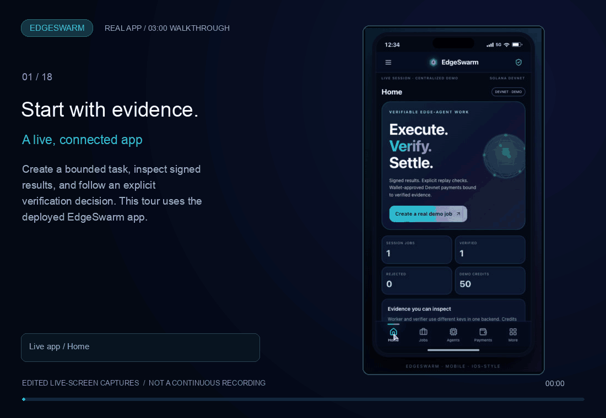
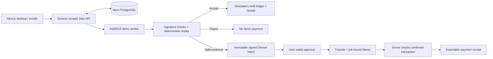

<div align="center">

# EdgeSwarm
### Signed work. Checked results. Inspectable receipts.

A full-stack prototype for verifiable edge-agent tasks, built with Next.js, PostgreSQL, and a Solana Devnet wallet demo.

[**Open the app**](https://edge-swarm.vercel.app/) · [Mobile experience](https://edge-swarm.vercel.app/mobile) · [Project website](https://codesbyfebin.github.io/EdgeSwarm/) · [Solana Devnet demo](https://edge-swarm.vercel.app/devnet-demo)

[](https://github.com/CodesbyFebin/EdgeSwarm/actions/workflows/ci.yml)
[](LICENSE)
[](docs/DEVNET_JUDGE_DEMO.md)
[](docs/AUDIT.md)


<h2><a href="https://edge-swarm.vercel.app/">Launch the live EdgeSwarm app</a></h2>

<a href="https://edge-swarm.vercel.app/"></a>

**3-minute looping walkthrough · 18 real captured scenes · click to open the live app.**

<sub>Edited, captioned screen captures with readable pauses—not a continuous screen recording. The Explorer scenes show the existing approved Devnet transaction; no new transfer was sent to create this walkthrough.</sub>

Use the real connected app: create a job, inspect verification, and prepare a Solana Devnet payment. No installation required.

[Read implementation guides](https://www.agentswarm.in/docs) · [Open desktop dashboard](https://edge-swarm.vercel.app/dashboard) · [Inspect the real Devnet payment](https://github.com/CodesbyFebin/EdgeSwarm/blob/main/docs/evidence/devnet-payment.json)

</div>

## Why this exists

An agent saying “done” is not enough to justify a payment. EdgeSwarm makes the evidence visible: a bounded task, a signed result, explicit verification checks, and a receipt. A tampered result takes the rejection path instead of receiving demo credits.

The current workload is deliberately small: uppercase a bounded text input and independently replay that transformation inside the backend. That makes the success and failure paths easy to inspect. It does **not** prove arbitrary AI output, establish an independent verifier trust domain, or attest to execution on a phone.

## Try it in two minutes

1. Open the [live app](https://edge-swarm.vercel.app/), enter a title and task input, and create a job.
2. Click **Execute → Verify → Simulate settlement**. Inspect the signed result, verification checks, and receipt.
3. Enable **Tamper with result**, create another job, and run it. It should be rejected without a simulated payment.
4. Open the [mobile app](https://edge-swarm.vercel.app/mobile) to follow the same backend workflow across ten screens.
5. For a verified job, open **Pay verified job on Solana Devnet**, select a recipient, and review the fixed 0.001 test-SOL intent before wallet approval. For an independent transfer, try the separate [Solana Devnet wallet demo](https://edge-swarm.vercel.app/devnet-demo) with a compatible wallet. Any transfer requires wallet approval and Devnet test SOL.

**Payment boundary:** Job credits are simulated. Verified jobs now expose a **job-linked Devnet payment flow**: a wallet-approved 0.001 test-SOL transfer with an evidence-bound Memo and server-side RPC checks. The recipient is chosen by the user; this is not on-chain escrow. The standalone Devnet demo remains separate. A real live-app end-to-end payment is recorded below; automated negative tests use synthetic RPC fixtures and are labeled as such.

## What is working

| Capability | Evidence / boundary |
|---|---|
| Live full-stack app | Vercel frontend and API, with Neon PostgreSQL session storage |
| Signed task results | Domain-separated Ed25519 worker signatures |
| Explicit verification | Identity, assignment, nonce, expiry, policy, task, reward, signature, integrity, and replay checks |
| Simulated settlement | Signed verifier verdict checked again before credit settlement; idempotent payment record |
| Serverless persistence | Signing identities and jobs restored across calls; atomic revision-checked updates |
| Browser-session isolation | HttpOnly SameSite cookie, same-origin writes, bounded JSON and job counts |
| Mobile interface | Ten-screen prototype connected to the Jobs API; some secondary controls are labeled UI-only |
| Android prototype | Kotlin P-256 signing/export code; debug APK built in CI, physical-device interoperability pending |
| Job-linked Solana Devnet | Immutable signed intent, exact transfer + job-bound Memo, server-side confirmation checks and receipt export |
| Standalone wallet demo | Separate Devnet transfer construction UI |

## Architecture



The worker and verifier use different signing keys in the **same backend**. This demonstrates separation of roles, not independent organizations or trusted hardware. PostgreSQL stores temporary demo signing material server-side; it is never returned by the API.

## Run locally

Node.js 22 recommended.

```sh
git clone https://github.com/CodesbyFebin/EdgeSwarm.git
cd EdgeSwarm
npm ci --ignore-scripts
npm test
npm run build
npm start -- --hostname 127.0.0.1 --port 3100
# In another terminal:
node scripts/smoke.mjs
```

Without a database URL, local sessions live in process memory. Restarting clears them. On Vercel, `DATABASE_URL` is required; missing shared storage fails closed. Sessions are temporary, not durable accounts.

| Route | Purpose |
|---|---|
| `/` | Final uploaded-app visual shell with ten connected workflow screens |
| `/dashboard` | Desktop task dashboard and receipts |
| `/jobs/:id/pay` | Verified-job Devnet payment and reconciliation |
| `/mobile` | Mobile workflow |
| `/devnet-demo` | Separate wallet-approved Solana Devnet transfer demo |
| `/api/health` | Configuration health; not a database connectivity probe |
| `/api/jobs` | Session-scoped job list and creation |
| `/api/jobs/:id` | Job inspection and bounded actions |
| `/api/metrics` | Session-scoped demo metrics |

## Real Solana Devnet evidence

The final app completed a verified-job payment on **Solana Devnet**: a job was created and verified, a disposable payer signed a **0.001 test-SOL** transfer with the evidence-bound Memo, and the live API validated and persisted its confirmed receipt. Repeating confirmation did not create another payment.

- [**Inspect the real transaction on Solana Explorer**](https://explorer.solana.com/tx/37XG6ENuZstcqzfDjcFRR4DnifS1bN12E2id1aAiJ58zTs9246xgonRiA9KmtuHpwmX237MLXkh3y6UhpDP9KqMk?cluster=devnet)
- [Exported job, signed intent and server-checked payment receipt](docs/evidence/devnet-payment.json)
- [Integration contract and trust boundaries](docs/SOLANA_INTEGRATION.md)
- Job: `5bb0aba5-8027-461e-a3ca-52bbc64161a6` · Slot: `520116661`

This proves one Devnet transfer through the live API flow, not on-chain enforcement of job verification, production readiness, or Android execution. The test used disposable keys held only in process memory; no wallet private keys were committed. The browser wallet-approval path still requires a separate compatible-wallet test.

## Tests and deployment evidence

The hardening and Solana integration passes expanded the baseline from **16 to 64 automated tests**, including adversarial payment-validation fixtures. Production build, TypeScript checks, hosted PostgreSQL concurrency tests, and live API smoke tests passed. The final-app integration commit `9a0febb` passed the web build, 64 tests, API smoke test and Android debug APK build in CI. Live API and real-RPC intent smoke tests also passed.

- [CI run and Android debug APK artifact](https://github.com/CodesbyFebin/EdgeSwarm/actions/runs/42511366802)
- [Audit findings and verified scope](docs/AUDIT.md)
- [Vercel deployment and environment setup](docs/DEPLOYMENT.md)
- [Security model and limitations](SECURITY.md)
- [Judge walkthrough](SUBMISSION.md)

The captured npm audit reported **zero high/critical and four moderate findings** in the Solana dependency chain. That is a dependency scan result, not a security certification. See the audit report before using the code beyond a demo.

## Roadmap, without inflated claims

- **Implemented:** verified-job Devnet intents, wallet transaction construction, Memo evidence binding, server-side transaction validation and downloadable receipts. Real transaction evidence must be linked separately; synthetic test fixtures are not chain evidence.
- **Then:** authenticated identities, independent verifier service, persistent user-owned receipts, and physical Android interoperability tests.
- **Later:** an on-chain escrow program with authorized release, replay protection, refund paths, and adversarial tests.

No Mainnet deployment, production authentication, independent verifier deployment, TEE attestation, zk proof, on-chain escrow, performance benchmark, or hackathon placement is claimed.

## Project map

```text
app/          Next.js UI and API routes
lib/          Task engine, evidence verification and session storage
android/      Kotlin EdgeAgent prototype
tests/        Node regression tests
scripts/      API and PostgreSQL integration smoke tests
docs/         Deployment, security evidence and historical design
index.html    GitHub Pages landing page, separate from the Vercel app
```

The earlier extended architecture proposal is preserved in [Design Blueprint](docs/DESIGN_BLUEPRINT.md). It is historical design intent, not a list of implemented guarantees.

## Contributing

Start with a reproducible issue or a small pull request. Include the behavior you changed, tests, and any security or deployment implications. Keep simulated data labeled. Never commit wallet secrets, database credentials, or claims of transactions without evidence.

Licensed under [Apache-2.0](LICENSE).

## Documentation and landing design

The uploaded landing design is adapted for GitHub Pages with real app/evidence links and no simulated live payout counters. The integration brings the current suite to **72 tests**. The `/docs` viewer provides repository-backed implementation guides and a separate, lazy-loaded 100-page unvalidated blueprint archive. Imported design claims and pseudocode are disclosed behind an explicit archive warning, not advertised as working APIs. See [integration notes](docs/SITE_INTEGRATION.md).
